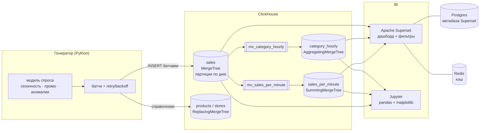

# Продуктовая сеть: end-to-end аналитика продаж

Учебный production-подобный стенд: генератор потока продаж → ClickHouse →
Apache Superset и Jupyter. Вся система поднимается одной командой
`docker compose up -d --build`.

**Предметная область — продуктовый магазин (вариант 2 «Интернет-магазин» в
трактовке офлайн+онлайн сети продуктовых супермаркетов).** Генератор пишет
позиции чеков с реалистичной суточной сезонностью, промо-акциями и редкими
аномалиями; ClickHouse хранит поток и считает агрегаты в Materialized View;
Superset показывает живой дашборд; ноутбук отвечает на аналитические вопросы.

---

## 1. Архитектура



Текстом: **генератор → ClickHouse (сырые продажи + MV) → Superset / Jupyter**.
Superset хранит метаданные в Postgres, кэширует результаты в Redis.

---

## 2. Быстрый старт

```bash
# 1. Настройки (значения по умолчанию рабочие, менять не обязательно)
cp .env.example .env

# 2. Поднять всё (сборка образов + запуск)
docker compose up -d --build

# 3. Дождаться инициализации BI (одноразовый сервис superset-init)
docker compose logs -f superset-init
```

| Сервис | URL | Логин / пароль |
|---|---|---|
| Superset | http://localhost:8088 | `admin` / `admin` |
| Jupyter | http://localhost:8888 | токен `grocery` |
| ClickHouse (HTTP) | http://localhost:8123 | `default` / `clickhouse_secret` |
| ClickHouse (native) | `localhost:9000` | `default` / `clickhouse_secret` |
| Postgres (метабаза) | `localhost:5432` | `superset` / `superset_secret` |
| Redis | `localhost:6379` | пароль `redis_secret` |

Дашборд Superset: **http://localhost:8088/superset/dashboard/grocery-sales-realtime/**

Полезные команды:

```bash
docker compose ps                 # статус и healthcheck
docker compose logs -f generator  # поток событий
make smoke                        # проверка, что данные реально пишутся
make notebook                     # выполнить ноутбук и сохранить графики
make screenshots                  # снять скриншоты дашборда (playwright)
docker compose down               # остановить (данные в volumes сохраняются)
docker compose down -v            # остановить и удалить данные
```

Первый старт занимает 3–5 минут: Superset применяет миграции метабазы,
затем `superset-init` создаёт подключение, датасеты, 6 визуализаций, дашборд
и два нативных фильтра.

---

## 3. Что происходит при старте

1. **Postgres** инициализируется и проходит healthcheck.
2. **Redis** поднимается с паролем и healthcheck.
3. **ClickHouse** создаёт БД `grocery`, выполняет `clickhouse/init/*.sql`
   (таблицы → агрегаты → Materialized View) и проходит healthcheck.
4. **Генератор** ждёт готовности ClickHouse, загружает справочники
   (`stores`, `products`), при пустой таблице `sales` делает backfill истории
   (`GENERATOR_BACKFILL_HOURS`, по умолчанию 24 ч), затем пишет поток батчами.
5. **Superset** применяет миграции, создаёт администратора и стартует.
6. **superset-init** (одноразово) логинится в Superset по API и создаёт:
   подключение к ClickHouse → датасеты → 6 чартов → дашборд → фильтры.
7. **Jupyter** доступен для анализа; ноутбук уже лежит в `jupyter/work/`.

---

## 4. Структура репозитория

```
.
├── docker-compose.yml          # вся система: 7 сервисов, volumes, healthcheck
├── .env.example                # все настройки и креды (в .env)
├── Makefile                    # up / down / logs / smoke / test / notebook
├── clickhouse/
│   └── init/                   # авто-инициализация схемы
│       ├── 01_schema.sql       # stores, products, sales
│       ├── 02_aggregates.sql   # sales_per_minute, category_hourly
│       └── 03_materialized_views.sql
├── generator/                  # Python-сервис генерации потока (пакет generator)
│   ├── cli.py                  # точка входа: python -m generator
│   ├── config.py               # pydantic-settings: GENERATOR_* / CLICKHOUSE_*
│   ├── models.py               # доменные объекты: Store, Product, SaleLine
│   ├── retry.py                # RetryPolicy: экспоненциальный backoff
│   ├── health.py               # /healthz, /readyz, /metrics
│   ├── generation/             # «как генерировать»: чистая математика спроса
│   │   ├── seasonality.py      # суточная/недельная/годовая сезонность
│   │   ├── anomalies.py        # типы аномалий, промо-календарь
│   │   ├── metrics.py          # самплеры чека (паттерн Strategy)
│   │   ├── catalog.py          # справочники: магазины с профилями, SKU
│   │   └── basket.py           # сборка чеков и батчей
│   ├── repository/             # порт хранилища и реализации
│   │   ├── base.py             # контракт Repository
│   │   ├── clickhouse.py       # ClickHouse: батчевый INSERT, ensure_schema
│   │   └── in_memory.py        # для тестов и запуска без БД
│   ├── service/generator.py    # оркестратор: цикл «батч → запись»
│   └── tests/                  # 55 юнит-тестов (unittest)
├── superset/
│   ├── Dockerfile              # apache/superset + clickhouse-connect
│   ├── superset_config.py      # Postgres, Redis, feature flags
│   ├── bootstrap.sh            # миграции, админ, gunicorn
│   └── provision.py            # автосоздание дашборда через API
├── jupyter/
│   ├── Dockerfile
│   └── work/grocery_store_analysis.ipynb
├── docs/
│   ├── acceptance-checklist.md # построчное соответствие чек-листу
│   ├── architecture.md
│   ├── runbook.md              # эксплуатация: запуск, сброс, логи
│   └── screenshots/            # графики и скриншоты (make screenshots)
└── scripts/
    ├── build_notebook.py       # пересборка .ipynb из кода
    ├── smoke_test.sh           # проверка живого стенда
    └── capture_dashboard.py    # скриншот дашборда через playwright
```

---

## 5. Модель данных

| Таблица | Движок | Ключ / партиции | Назначение |
|---|---|---|---|
| `grocery.stores` | `ReplacingMergeTree(updated_at)` | `ORDER BY store_id` | справочник магазинов (город, формат) |
| `grocery.products` | `ReplacingMergeTree(updated_at)` | `ORDER BY product_id` | справочник товаров (категория, цена, поставщик) |
| `grocery.sales` | `MergeTree` | `PARTITION BY toYYYYMMDD(event_time)`, `ORDER BY (city, category, event_time)` | поток позиций чеков |
| `grocery.sales_per_minute` | `SummingMergeTree` | `PARTITION BY toYYYYMM(minute)`, `ORDER BY (minute, city, category)` | минута × город × категория |
| `grocery.category_hourly` | `AggregatingMergeTree` | `PARTITION BY toYYYYMM(hour)`, `ORDER BY (hour, category)` | час × категория, `sumState`/`uniqState` |

Связи: `sales.product_id → products.product_id`,
`sales.store_id → stores.store_id` (два связанных потока + справочники).

Поля события `sales` (помимо `order_id`/`event_time`): `city`, `store_format`,
`product_name`, `category`, `quantity`, `unit_price`, `discount_rate`, `revenue`,
`margin`, `payment_method`, `channel`, `is_promo`, `is_anomaly` — есть и
размерности (город, категория, канал), и метрики (выручка, маржа, количество).

`discount_rate` — доля скидки в диапазоне 0..1, `Decimal(5, 4)`:
`0.1500` = 15%, а не целые проценты. Выручка считается как
`unit_price × quantity × (1 − discount_rate)`.

### Почему именно такие движки

* `MergeTree` + партиции по дню + `ORDER BY` под частые срезы — стандарт для
  event-таблиц: быстрый скан «город/категория/время», дешёвое удаление
  старых партиций (плюс `TTL` 180 дней).
* `SummingMergeTree` — когда нужны простые суммы: ClickHouse сам складывает
  неключевые числовые колонки при merge.
* `AggregatingMergeTree` — когда нужны «нескладываемые» агрегаты:
  `uniqState(order_id)` для уникальных заказов и `sumState` в `Decimal(38,2)`,
  чтобы не переполнить `Decimal(12,2)`.
* `ReplacingMergeTree(updated_at)` — справочники: новая версия строки с тем же
  ключом вытесняет старую (обновление цен, стоп-лист).

### Materialized View

```sql
-- MV срабатывает на каждый INSERT в sales, витрины обновляются сами
CREATE MATERIALIZED VIEW grocery.mv_sales_per_minute TO grocery.sales_per_minute AS
SELECT toStartOfMinute(event_time) AS minute, city, category,
       sum(quantity) AS items, sum(revenue) AS revenue, ...
FROM grocery.sales GROUP BY minute, city, category;

CREATE MATERIALIZED VIEW grocery.mv_category_hourly TO grocery.category_hourly AS
SELECT toStartOfHour(event_time) AS hour, category,
       sumState(toDecimal128(revenue, 2)) AS revenue_state,
       uniqState(order_id) AS orders_state, countState() AS events_state
FROM grocery.sales GROUP BY hour, category;
```

Проверка «real-time»:

```bash
docker compose exec clickhouse clickhouse-client -q \
  "SELECT count() FROM grocery.sales_per_minute"
docker compose exec clickhouse clickhouse-client -q \
  "SELECT category, sumMerge(revenue_state) AS revenue
   FROM grocery.category_hourly GROUP BY category ORDER BY revenue DESC"
```

---

## 6. Генератор

Структура повторяет эталонную архитектуру потоковых генераторов: домен
(`models.py`) отделён от генерации (`generation/`), генерация — от хранилища
(`repository/` порт + две реализации), оркестрация — в `service/`. Поэтому
генератор тестируется без ClickHouse (in-memory репозиторий) и легко
расширяется новой метрикой — одним классом-стратегией.

Что моделируется:

* **Сезонность** — чистые функции времени: суточная волна (пик ~19:30,
  ночной провал ~03:30), день недели (выходные активнее), годовая
  (пик в декабре) и «зарплатные» дни (1–5 и 15–20 числа). Итоговый
  множитель интенсивности ~0.1…2.5 применён к потоку чеков.
* **Промо-акции** — детерминированный календарь: в половине 30-минутных
  окон одна категория получает скидку 12–30 % и всплеск спроса; строки
  помечаются `is_promo = 1`.
* **Аномалии** — это *тип* отклонения, как в эталоне: `PANIC_BUYING`
  (чек раздувается в разы), `BULK_PURCHASE` (оптовая закупка одной позиции),
  `PRICE_GLITCH` (сбой ценника, цена падает до ~15 %). Вероятность и сила
  настраиваются (`GENERATOR_ANOMALY_PROBABILITY`, `..._STRENGTH`), все строки
  аномального чека получают `is_anomaly = 1`. Дальше эти выбросы ищет ноутбук.
* **Чеки** — строки группируются в заказы с общим `order_id`, магазином,
  способом оплаты, каналом и временем; размер корзины и отклик на промо
  зависят от профиля формата магазина (супермаркет / минимаркет / даркстор).

Надёжность:

* запись **батчами** — `repository/clickhouse.py` вставляет пачку строк
  одним `INSERT`;
* **retry с экспоненциальным backoff** (`retry.py`): попыток —
  `GENERATOR_RETRY_MAX_ATTEMPTS`, пауза растёт с фактором 2 и обрезается
  `max_delay`;
* **graceful shutdown** по SIGTERM/SIGINT: цикл останавливается,
  health-сервер гасится, счётчики выводятся в лог;
* **healthcheck**: `/healthz` отдаёт 503, если последняя успешная запись
  была более 120 с назад;
* воспроизводимость: тот же `GENERATOR_SEED` даёт тот же поток.

Параметры (все — переменные окружения, см. `.env.example`):

| Переменная | По умолчанию | Смысл |
|---|---|---|
| `GENERATOR_SEED` | 42 | seed, поток воспроизводим |
| `GENERATOR_ORDERS_PER_MINUTE` | 60 | базовая интенсивность, чеков/мин (до сезонных множителей) |
| `GENERATOR_INTERVAL_SECONDS` | 2 | пауза между тиками генерации |
| `GENERATOR_BATCH_SIZE` | 20 | максимум чеков в одном тике |
| `GENERATOR_ANOMALY_PROBABILITY` | 0.005 | вероятность аномалии на чек |
| `GENERATOR_ANOMALY_STRENGTH` | 3 | множитель силы аномалии |
| `GENERATOR_STORE_COUNT` | 6 | сколько магазинов в сети |
| `GENERATOR_PRODUCT_COUNT` | 90 | число SKU |
| `GENERATOR_BACKFILL_HOURS` | 24 | сколько истории сгенерировать при пустой БД |
| `GENERATOR_RETRY_MAX_ATTEMPTS` | 5 | попыток записи в ClickHouse |

Локальная проверка без Docker:

```bash
cd generator
python -m unittest discover -s tests -v   # 55 тестов
cd ..
python -m generator --dry-run 5           # чеки без записи в ClickHouse
python -m generator --once                # справочники + один батч в память
```

---

## 7. Superset: дашборд и фильтры

`superset-init` создаёт дашборд **«Продуктовая сеть: продажи в реальном
времени»** с 6 визуализациями:

| # | Визуализация | Тип | Источник |
|---|---|---|---|
| 1 | Выручка по минутам | line | MV `sales_per_minute` |
| 2 | KPI: выручка за последний час | Big Number | MV `category_hourly` (`sumMerge`) |
| 3 | Выручка по категориям | bar | MV `category_hourly` |
| 4 | Способы оплаты | pie | `sales` |
| 5 | Топ-10 товаров по выручке | table | `sales` |
| 6 | Выручка по городам | bar | MV `sales_per_minute` |

Интерактивные фильтры (нативные, в шапке дашборда):

* **Период** (`filter_time`) — по умолчанию «Last 6 hours»;
* **Категория** (`filter_select`, мультивыбор) — фильтрует чарты по
  `category` на всех трёх event-датасетах.

Инициализация полностью автоматическая (`superset-init` — идемпотентный
`provision.py`, работает через REST API Superset): подключение ClickHouse,
датасеты, чарты, дашборд, фильтры. Руками ничего создавать не нужно.

---

## 8. Jupyter

Ноутбук `jupyter/work/grocery_store_analysis.ipynb`:

1. подключается к ClickHouse через `clickhouse-connect`;
2. **6 аналитических запросов**: сводка за 3 дня, суточный профиль,
   категории из MV (`sumMerge`/`uniqMerge`), топ-10 товаров, аномалии,
   срез по оплате и каналу;
3. **3 графика** (matplotlib): суточный профиль, выручка по категориям,
   минутная выручка с отмеченными аномалиями;
4. **поиск аномалий** робастным z-score (медиана и MAD в окне 15 минут)
   и сверка с заложенным флагом `is_anomaly`;
5. текстовые выводы по каждому блоку.

Запуск:

```bash
make notebook
# или
docker compose exec jupyter jupyter nbconvert --to notebook --execute \
    --inplace /home/jovyan/work/grocery_store_analysis.ipynb
```

Внутри контейнера Jupyter рабочий каталог уже `/home/jovyan/work`, поэтому
путь к ноутбуку указываем абсолютный — иначе получится `work/work/...`.

Графики сохраняются в `docs/screenshots/` (volume
`./docs/screenshots:/home/jovyan/figures`).

---

## 9. Проверка работы (для защиты)

```bash
# 1. Всё поднято и здорово
docker compose ps

# 2. Данные реально пишутся
docker compose exec clickhouse clickhouse-client -q "SELECT count() FROM grocery.sales"
docker compose exec clickhouse clickhouse-client -q \
  "SELECT max(event_time), count() FROM grocery.sales"

# 3. Materialized View наполняется
docker compose exec clickhouse clickhouse-client -q \
  "SELECT max(minute), sum(revenue) FROM grocery.sales_per_minute"

# 4. Superset жив, дашборд создан
curl -fsS http://localhost:8088/health
docker compose exec superset superset fab list-users

# 5. Данные переживают перезапуск
docker compose restart clickhouse generator
docker compose exec clickhouse clickhouse-client -q "SELECT count() FROM grocery.sales"
```

`make smoke` выполняет эти проверки автоматически.

---

## 10. Скриншоты

| Файл | Что на нём |
|---|---|
| `docs/screenshots/dashboard.png` | дашборд Superset целиком |
| `docs/screenshots/jupyter_diurnal_profile.png` | суточный профиль продаж |
| `docs/screenshots/jupyter_category_revenue.png` | выручка по категориям |
| `docs/screenshots/jupyter_anomalies.png` | минутная выручка и аномалии |

Получаются одной командой после запуска стенда:

```bash
make screenshots   # playwright заходит в Superset и снимает дашборд
make notebook      # выполняет ноутбук -> PNG в docs/screenshots/
```

Это сделано намеренно: скриншоты снимаются с **живого** стенда, поэтому не
устаревают. Инструкция и требования (playwright-образ) — в
`docs/screenshots/README.md`.

---

## 11. Соответствие чек-листу приёмки

| Пункт чек-листа | Где реализовано |
|---|---|
| README: описание, схема, запуск, порты, креды | этот файл, разделы 1–2 |
| `.env.example`, нет хардкода кредов | `.env.example`, `docker-compose.yml`, `superset_config.py` |
| `docker compose up` одной командой | `docker-compose.yml` |
| Все 6 сервисов + Jupyter | `docker-compose.yml` |
| Named volumes для ClickHouse и Postgres | `volumes: clickhouse_data, postgres_data` |
| Healthcheck и порядок старта | `healthcheck` + `depends_on: condition: service_healthy` |
| Данные переживают перезапуск | volumes + `make smoke` |
| Генератор стартует сам, пишет батчами | `generator/service/generator.py`, `repository/clickhouse.py` |
| 2+ связанных потока, 4+ поля, размерность и метрика | `grocery.sales`, `products`, `stores` |
| Сезонность, тренд, аномалии | `generator/generation/seasonality.py`, `anomalies.py` |
| Env-конфигурация, retry/backoff, graceful shutdown | `generator/config.py`, `retry.py`, `service/generator.py` |
| Схема создаётся автоматически | `clickhouse/init/*.sql` |
| MergeTree, партиции, ORDER BY, MV | `01_schema.sql`, `02_aggregates.sql`, `03_materialized_views.sql` |
| Superset: автоинициализация, clickhouse-connect | `superset/bootstrap.sh`, `provision.py` |
| 4+ визуализации и фильтр | `provision.py` (6 чартов, 2 фильтра) |
| Визуализация на данных MV | чарты №1, №2, №3, №6 |
| Jupyter: 3+ запроса, 2+ графика, выводы | `grocery_store_analysis.ipynb` |
| Чистая структура, логи, линт | `Makefile`, `scripts/`, логирование в сервисах |
| История коммитов | `git log --oneline` (поэтапные коммиты) |

Подробный разбор — `docs/acceptance-checklist.md`.

---

## 12. Ограничения и что дальше

* Стенд учебный: пароли по умолчанию, TLS выключен, `PREVENT_UNSAFE_DB_CONNECTIONS = False`.
* Superset работает на gunicorn без Celery — фоновые отчёты/алерты отключены.
* Один экземпляр ClickHouse без репликации; для production — `ReplicatedMergeTree` + Keeper.
* Генератор синтетический: данные правдоподобны, но не являются реальными продажами.

Возможные улучшения: брокер (Redpanda/Kafka) между генератором и ClickHouse,
второй consumer для алертов, dbt для витрин, прогноз спроса в ноутбуке.

---

## 13. Траблшутинг

| Симптом | Что делать |
|---|---|
| `grocery-redis` unhealthy | Healthcheck читает `REDIS_PASSWORD` из окружения контейнера — переменная должна быть в `environment:` сервиса (уже добавлена). Проверка: `docker exec grocery-redis redis-cli -a redis_secret ping` |
| Superset в `Restarting`, в логах `DistributionNotFound: The 'redis<5.0,>=4.5.4'` | В `superset/requirements.txt` несовместимая версия redis. Должно быть `redis>=4.5.4,<5`; после правки — `docker compose build superset && docker compose up -d` |
| `grocery-clickhouse` unhealthy, остальные сервисы не стартуют | Это каскад: Compose ждёт healthy-ClickHouse. Смотреть `docker compose logs clickhouse`. Чаще всего — старый том с другим паролем или упавший init-скрипт: `docker compose down -v && docker compose up -d --build` |
| В логах ClickHouse `Authentication failed` | Пароль в `.env` не совпадает с тем, с которым создан том. Либо вернуть прежний пароль, либо `docker compose down -v` |
| В логах ClickHouse `Address already in use` | Заняты порты 8123/9000: `Get-NetTCPConnection -LocalPort 8123,9000`, остановить другой ClickHouse или поменять `CLICKHOUSE_HTTP_PORT_HOST` |
| ClickHouse убит (OOM) | Docker Desktop → Settings → Resources: выделить ≥ 4 ГБ памяти |
| `superset-init` упал с ошибкой подключения | `docker compose logs superset` — вероятно, миграции ещё идут; перезапустить: `docker compose up -d superset-init` |
| Пустые графики в Superset | Проверить `docker compose logs generator`; данных может быть мало — подождать 2–3 минуты или увеличить `GENERATOR_BACKFILL_HOURS` |
| `port is already allocated` | Поменять порты в `.env` (`SUPERSET_PORT`, `CLICKHOUSE_HTTP_PORT_HOST`, ...) |
| ClickHouse не стартует после смены init-скриптов | Init выполняется только на пустом volume: `docker compose down -v && docker compose up -d --build` |
| Ноутбук не видит ClickHouse | Проверить `CLICKHOUSE_*` в `docker compose config`; хост внутри сети — `clickhouse`, порт `8123` |
| В Jupyter пустые витрины (`category_hourly` = 0 строк) | Materialized View не создались. Проверить `SELECT name FROM system.tables WHERE name LIKE 'mv_%'`. Init-скрипты идемпотентны и выполняются при каждом старте ClickHouse: достаточно `docker compose restart clickhouse`, в крайнем случае `docker compose down -v && docker compose up -d --build` |
| «Не открывается» ClickHouse в браузере | Корень `http://localhost:8123` отвечает `Ok.` — это нормальный health-check. Редактор запросов: `http://localhost:8123/play`, логин `default`, пароль из `CLICKHOUSE_PASSWORD` |
| Не скачивается `quay.io/jupyter/...` | Заменить базовый образ в `jupyter/Dockerfile` на `docker.io/jupyter/scipy-notebook:2024-10-07` (он идентичен) |
| Долго тянется `apache/superset:4.0.2` | Образ ~1 ГБ; при слабой сети — `docker compose pull superset` заранее |
